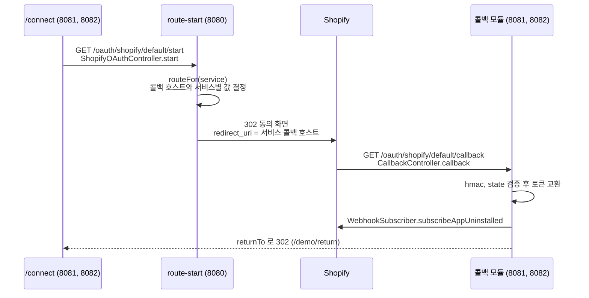
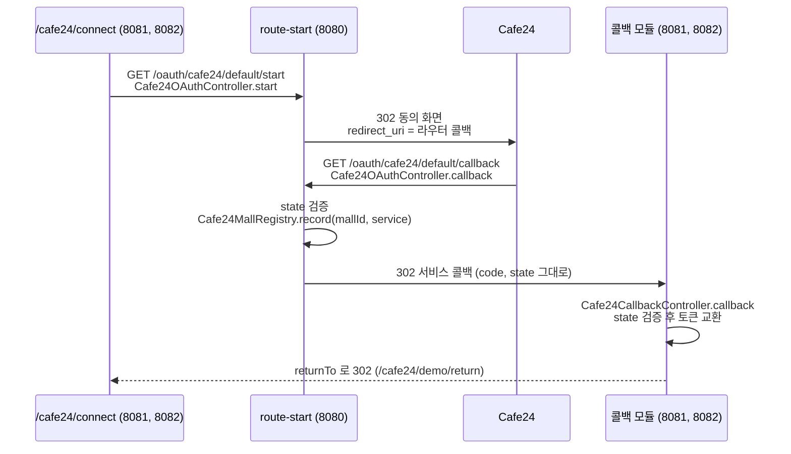
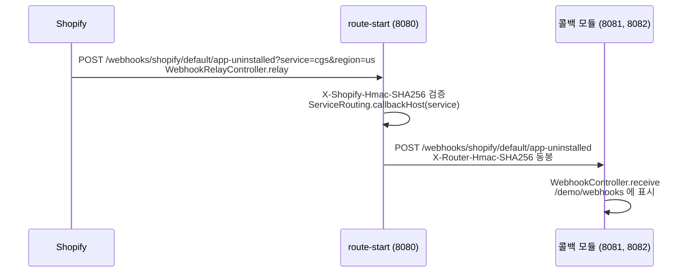
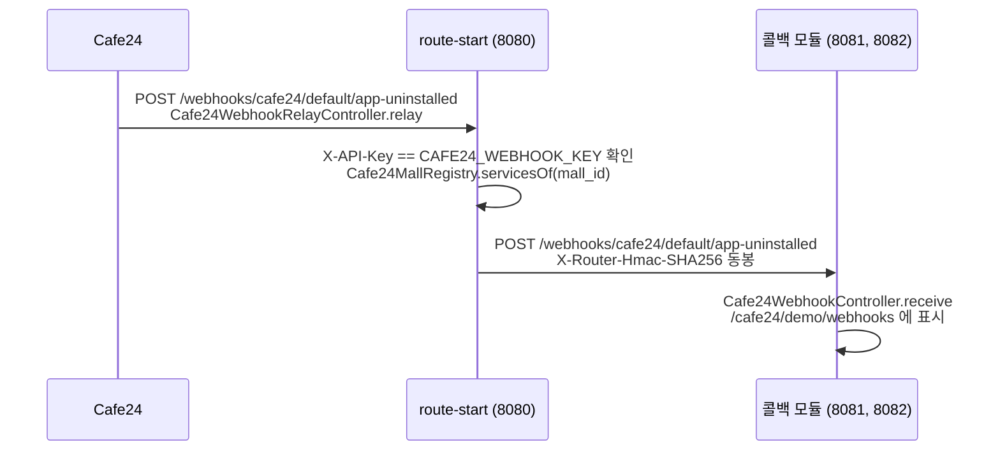

# ceip-route-stub

> **목적** Shopify 와 Cafe24 의 OAuth authorization code 흐름과 웹훅 릴레이를 검증하는 임시 테스트 스텁이다.

정식 라우트 서비스(기술 스택, 저장소명 미정)가 나오기 전까지만 쓴다.

경로는 라우트 서비스 규약 `/oauth/{channel}/{plane}/{action}` 을 따른다. Shopify 와 Cafe24 는 plane 분리가 없어 `{plane}` 에 `default` 를 쓴다. region, service, returnTo 는 어느 리전과 소비 서비스가 인증을 시작했고 인증 뒤 어디로 돌려보낼지 나타내는 값이다. 라우터는 이 값들을 서명한 `state` 에 실어 콜백까지 왕복시킨다(무상태).

## 모듈 구성

이 스텁은 앱의 App URL 호스트와 콜백(redirect_uri) 호스트를 서로 다른 호스트로 두어도 인증이 성립하는지 본다. 그래서 세 모듈을 다른 포트와 다른 터널로 띄운다.

| 역할 | 모듈 | 포트 | 터널 | Shopify 필드 |
|---|---|---|---|---|
| start | route-start | 8080 | ngrok(고정 도메인) | App URL |
| callback (cgs) | callback-cgs | 8081 | cloudflared(quick tunnel 1) | Allowed redirection URL(s) |
| callback (colo1.0) | callback-colo | 8082 | cloudflared(quick tunnel 2) | Allowed redirection URL(s) |

세 모듈은 별도 부트 앱이다. 콜백 모듈은 route-start 와 격리하려고 코덱을 복제했고, 같은 FQCN 을 두 모듈에 두지 않도록 패키지를 달리 둔다. callback-colo 는 callback-cgs 의 복제본이고 패키지(`callbackcolo`)와 연결 화면 기본값(service=colo1.0, region=kr)만 다르다.

```
ceip-route-stub/
├── settings.gradle                   # include 'route-start', 'callback-cgs', 'callback-colo'
├── build.gradle                      # 플러그인 버전과 세 모듈 공통 설정(subprojects)
├── route-start/  (8080)              com.colosseum.routestub
│   ├── RouteStubApplication
│   ├── config/ShopifyProperties      # apiKey, apiSecret, appHost, callbackHost, scopes, returnAllowlist
│   ├── config/Cafe24Properties       # clientId, clientSecret, scopes, webhookKey
│   ├── shopify/                      # start, refresh, 웹훅 릴레이
│   │   ├── ShopifyOAuthController    # service switch 로 서비스별 값을 state 에 싣는다
│   │   ├── ServiceRouting            # service → 소비 서비스 호스트 (redirect_uri, 웹훅 전달처)
│   │   ├── WebhookRelayController    # X-Shopify-Hmac-SHA256 검증 후 소비 서비스로 전달
│   │   ├── StateCodec
│   │   └── HmacVerifier              # 콜백 hmac(hex) + 웹훅 hmac(base64)
│   └── cafe24/                       # start, 라우터 콜백, 웹훅 릴레이
│       ├── Cafe24OAuthController     # start, 라우터 콜백(서비스 콜백으로 302)
│       ├── Cafe24WebhookRelayController  # X-API-Key 확인 후 몰을 연결한 서비스로 전달
│       ├── Cafe24MallRegistry        # mallId → 연결한 service 기록(메모리)
│       └── Cafe24StateCodec
├── callback-cgs/  (8081)             com.colosseum.routestub.callbackcgs
│   ├── CallbackStubApplication
│   ├── config/ShopifyProperties      # apiKey, apiSecret, appHost(/connect 폼, 웹훅 구독 주소), apiVersion, returnAllowlist
│   ├── config/Cafe24Properties
│   ├── resources/templates/connect.html  # /connect 화면. {{startUrl}} 을 컨트롤러가 치환
│   ├── resources/templates/cafe24-connect.html
│   ├── shopify/                      # connect, callback, token/refresh, demo/return, 웹훅 수신
│   │   ├── ConnectController         # 소비 서비스 연결 화면 데모(/connect)
│   │   ├── CallbackController
│   │   ├── WebhookSubscriber         # 토큰 교환 직후 app/uninstalled 구독 생성(GraphQL)
│   │   ├── WebhookController         # 라우터가 전달한 웹훅 수신, /demo/webhooks
│   │   ├── StateCodec                # route-start 복제본
│   │   └── HmacVerifier              # route-start 복제본
│   └── cafe24/                       # connect, callback, token, demo/return, 웹훅 수신
│       ├── Cafe24ConnectController
│       ├── Cafe24CallbackController
│       ├── Cafe24WebhookController
│       └── Cafe24StateCodec          # route-start 복제본
└── callback-colo/  (8082)            com.colosseum.routestub.callbackcolo
    └── (callback-cgs 와 같은 구성)
```

## Shopify 와 Cafe24 흐름 차이

두 채널은 공통 인터페이스나 베이스 클래스로 묶지 않고 채널별 패키지로 나눠 둔다. 근거는 다음 두 가지다.

1) 단계마다 다른 콜백 경로와 검증 방식을 한 추상화로 묶으면 채널별 분기가 추상화 안쪽으로 숨는다.
2) 이 스텁은 두 채널의 흐름 차이를 검증하려고 만들었다.

### 인증 흐름

Shopify 는 start 가 서비스별 콜백 호스트를 redirect_uri 로 바로 보내고, Shopify 가 그 호스트로 code 를 보낸다.



Cafe24 는 라우터 콜백 하나만 등록하고, 라우터가 서명 state 의 service 로 서비스 콜백을 골라 code, state 를 그대로 넘긴다(302).



Cafe24 에 서비스별 콜백을 쓰지 않는 이유는 Redirect URI(s) 동작에 있다. Redirect URI(s) 를 여러 줄 등록하면 Cafe24 는 동의 뒤 우리가 보낸 redirect_uri 와 무관하게 그 줄들을 이어 붙인 주소(`https://a/...callbackhttps://b/...callback`)로 보냈고, 결과는 404 였다. 토큰 교환의 redirect_uri 는 authorize 때 값과 같아야 해서 start 가 라우터 콜백 주소를 state 에 싣고, 서비스 콜백은 state 의 라우터 콜백 주소를 그대로 쓴다.

### 웹훅 흐름

Shopify 는 shop 별 구독 주소의 service 쿼리로 전달처를 정한다.



Cafe24 는 앱 단위 주소 하나로 받고, 본문의 mall_id 로 전달처를 정한다.



### 단계별 차이

| 항목 | Shopify | Cafe24 |
|---|---|---|
| redirect_uri | 서비스별 콜백 호스트(여러 개 등록) | - 라우터 콜백 하나(`APP_HOST`)<br>- 라우터가 서비스 콜백으로 302 |
| 동의 화면 | `https://{shop}/admin/oauth/authorize` | `https://{mallId}.cafe24api.com/api/v2/oauth/authorize?response_type=code` |
| scope 구분 | 콤마 | 공백(설정은 콤마로 두고 start 가 공백으로 변환) |
| 콜백 검증 | hmac(정렬 쿼리) + 서명 state | 서명 state 만(hmac 없음) |
| 토큰 교환 | 본문에 client_id, client_secret | - `Authorization: Basic base64(client_id:client_secret)`<br>- 본문에 grant_type, code, **redirect_uri**(라우터 콜백) |
| code 유효 | - | 1분, 1회(라우터 302 를 거쳐도 충분) |
| 토큰 | offline(비만료) 또는 expiring | - access_token 2시간 + refresh_token 2주(항상)<br>- 만료는 `expires_at` 시각 |
| 토큰 API | 갱신 | 갱신, API 호출 확인, 폐기 |
| 웹훅 등록 | shop 별 GraphQL 구독(주소에 service 쿼리) | 개발자센터에 앱 단위 주소 하나 |
| 웹훅 검증 | X-Shopify-Hmac-SHA256(본문 HMAC) | X-API-Key(개발자센터 "인증정보" 고정값), 서명 없음 |
| 웹훅 본문 | shop 정보 | `{"event_no":90077,"resource":{"mall_id","client_id","app_name","deleted_date"}}` |
| 웹훅 전달처 | 구독 주소 쿼리의 service | - `resource.mall_id` 로 라우터 연결 기록(`Cafe24MallRegistry`)에서 찾은, 그 몰을 연결한 서비스 전부<br>- 기록이 없으면 cgs, colo1.0 모두 |

## 실행 준비

### 준비물

- JDK 21 (프로젝트 toolchain 을 21 로 고정)
- Shopify 앱(`dev-ceip-app`)의 Client ID, Client secret
- ngrok 무료 고정 도메인(8080, App URL)
- cloudflared(8081, 콜백), quick tunnel 은 계정 불필요
- 테스트용 개발 스토어(`test-ceip-store.myshopify.com`)

### 자격증명

secret 은 코드나 설정에 넣지 않고 환경변수로 준다. `env.sh` 는 gitignore 대상이다.

```bash
# env.sh (env.sh.example 을 복사해 값 채움)
export SHOPIFY_API_KEY=<Client ID>
export SHOPIFY_API_SECRET=<Client secret>
export APP_HOST=https://cassette-blouse-tricolor.ngrok-free.dev
export CALLBACK_HOST=https://beef-surge-concentrate-cdna.trycloudflare.com
# colo1.0 콜백 모듈(8082)의 cloudflared 주소. start 가 service=colo1.0 이면 이 호스트로 redirect_uri 를 만든다.
export CALLBACK_HOST_COLO1=https://troy-symphony-parameters-getting.trycloudflare.com
# 선택: 절대 URL returnTo 를 허용할 호스트(콤마 구분). 상대 경로만 쓰면 불필요.
export SHOPIFY_RETURN_ALLOWLIST=cgs.example.com,colo.example.com
# 선택: 웹훅 구독에 쓰는 GraphQL Admin API 버전. 기본 2026-07.
export SHOPIFY_API_VERSION=2026-07
# 선택: 개인정보 웹훅 3종의 접수 담당 service(cgs, colo1.0, colo-nova). 기본 cgs.
export COMPLIANCE_SERVICE=cgs
```

Cafe24 env 는 `CAFE24_CLIENT_ID`, `CAFE24_CLIENT_SECRET`, `CAFE24_MALL_ID`, (선택) `CAFE24_SCOPES` 이고 세 앱 모두 같은 값을 읽는다.

IntelliJ 처럼 셸을 거치지 않고 켤 때를 위해 모듈은 프로젝트 루트의 `.env`(같은 키, `export` 없이 `KEY=value`)도 읽는다(`spring.config.import`). 환경변수가 있으면 환경변수가 우선한다. cloudflared 주소가 바뀌면 `env.sh` 와 `.env` 를 함께 고친다.

- `APP_HOST`: start 의 공개 호스트(App URL)다. 콜백 모듈의 `/connect` 화면도 이 값으로 start 폼 주소를 만든다.
- `CALLBACK_HOST`: start 가 만드는 `redirect_uri` 의 호스트이고, Shopify 에 등록한 Redirect URL 호스트와 같아야 한다. 값을 안 주면 `APP_HOST` 로 폴백해 두 호스트가 같아진다(기존 동작).
- `SHOPIFY_API_SECRET`: 두 모듈이 같은 값을 써야 state 와 hmac 이 맞물린다.

### 실행

start(8080), callback cgs(8081), callback colo1.0(8082)을 각각 띄운다. 콜백 모듈도 같은 env 를 읽는다.

```bash
source env.sh
./gradlew :route-start:bootRun    # start 모듈, 8080
```

```bash
source env.sh
./gradlew :callback-cgs:bootRun   # 콜백 모듈(cgs), 8081
```

```bash
source env.sh
./gradlew :callback-colo:bootRun  # 콜백 모듈(colo1.0), 8082
```

포트가 겹치면 `lsof -ti:8080 | xargs kill` 로 정리한다(8081, 8082 도 같은 식).

### 터널

```bash
ngrok http 8080 --url=https://cassette-blouse-tricolor.ngrok-free.dev
```

```bash
cloudflared tunnel --url http://localhost:8081   # cgs 콜백 → CALLBACK_HOST
```

```bash
cloudflared tunnel --url http://localhost:8082   # colo1.0 콜백 → CALLBACK_HOST_COLO1
```

무료 ngrok 은 계정당 도메인이 하나라 두 번째 호스트를 만들 수 없어서, 콜백은 cloudflared quick tunnel 로 띄운다. **quick tunnel 주소는 실행마다 바뀐다.** 주소가 바뀌면 두 곳을 다시 맞춘다.

- `env.sh` 와 `.env` 의 `CALLBACK_HOST`(8081), `CALLBACK_HOST_COLO1`(8082), 그리고 start 앱 재기동
- Shopify 앱의 Allowed redirection URL(s)

quick tunnel 은 개수 제한이 없어서 프로세스를 하나 더 띄우면 다른 `*.trycloudflare.com` 호스트가 하나 더 생긴다. 한 프로세스로 여러 호스트를 두려면 Cloudflare 계정과 본인 도메인으로 named tunnel 을 만들고 ingress 규칙으로 호스트별 경로를 지정해야 한다. 스텁 검증에는 quick tunnel 두 개면 충분하다.

## Shopify

### Shopify 엔드포인트

| 경로 | 파라미터 | 동작 | 모듈 |
|---|---|---|---|
| `GET /` | 없음 | 공용 연결 화면(테스트 하네스) | route-start(8080) |
| `GET /connect` | 없음 | - 소비 서비스 연결 화면 데모<br>- sellerId, warehouseId, 만료형 체크 + 서비스 보유 값(channel, region, service, shop, returnTo)을 8080 `/start` 로 GET | callback-cgs(8081, cgs), callback-colo(8082, colo1.0) |
| `GET /oauth/shopify/{plane}/start` | shop, channel, region, service, returnTo, sellerId, warehouseId, online, expiring | service 로 콜백 호스트를 고르고 서비스별 값을 state 에 실어 Shopify 동의 화면으로 302 | route-start(8080) |
| `GET /oauth/shopify/{plane}/refresh` | shop, region, service, returnTo | online 그랜트 재실행 | route-start(8080) |
| `GET /oauth/shopify/{plane}/callback` | code, hmac, state, shop | hmac, state 검증 후 토큰 교환, returnTo 로 302 | callback-cgs(8081), callback-colo(8082) |
| `POST /oauth/shopify/{plane}/token/refresh` | result | 보관한 refresh_token 으로 `grant_type=refresh_token` 교환, 결과를 demo/return 으로 302 | callback-cgs(8081), callback-colo(8082) |
| `GET /demo/return` | result(콜백이 붙임) | - 원 서비스 복귀 데모 화면<br>- result id 로 콜백이 보관한 토큰 응답을 표로 표시 | callback-cgs(8081), callback-colo(8082) |
| `POST /webhooks/shopify/{plane}/{topic}` | service, region(구독 주소 쿼리) + Shopify 헤더와 본문 | - 라우터 릴레이, X-Shopify-Hmac-SHA256 검증 후 service 의 소비 서비스로 전달(라우터 서명 동봉)<br>- 개인정보 3종은 service 없이 `COMPLIANCE_SERVICE` 로 폴백<br>- 실패 시 502 | route-start(8080) |
| `POST /webhooks/shopify/{plane}/{topic}` | 라우터가 전달한 헤더와 본문 | 소비 서비스 수신, X-Router-Hmac-SHA256 만 확인하고 메모리에 보관 | callback-cgs(8081), callback-colo(8082) |
| `GET /demo/webhooks` | 없음 | 받은 웹훅을 최근 순으로 표시 | callback-cgs(8081), callback-colo(8082) |

### 토큰 종류

`expiring` 은 콜백까지 서명 state 에 실려 가고, 콜백이 토큰 교환 POST 본문에 `expiring=1` 을 붙인다. Shopify 는 이 값이 없으면 비만료 offline 토큰을 준다. public 앱은 2027-01-01 부터 만료형 offline 토큰이 필수다. 콜백은 로그 `[callback] expiring 요청= refresh_token 발급=` 줄로 실제 발급 여부를 남긴다.

| 선택 | 요청 | 응답 | refresh_token |
|---|---|---|---|
| 기본 | 없음 | `shpat_`, expires_in 없음(비만료 offline) | 없음 |
| `expiring=true` | 토큰 교환에 `expiring=1` | expires_in 3600, `refresh_token`(shprt_), refresh_token_expires_in 7776000 | 있음(demo 화면의 갱신 버튼이 `/token/refresh` 로 교환) |
| `online=true` | authorize 에 `grant_options[]=per-user` | `shpua_`, expires_in 86400, associated_user | 없음(`/refresh` 로 재인증) |

### 소비 서비스 값 전달

8081 의 `/connect` 는 소비 서비스가 자기 화면에서 sellerId, warehouseId 를 받아 라우터 start 로 넘기는 흐름을 흉내 낸다.

- 사용자가 입력하는 값은 sellerId, warehouseId 뿐이다.
- channel, region, service, shop, returnTo 는 서비스가 이미 보유한 값이라 readonly 로 함께 보낸다.
- 폼 action 은 `APP_HOST` + `/oauth/shopify/default/start` 다(콜백 모듈도 `APP_HOST` 를 읽는다).

start 는 `service` 로 switch 해 redirect_uri 를 만들 콜백 호스트와 서비스별로 실어 나를 값을 정한다(`ShopifyOAuthController.routeFor`). 지금은 cgs, colo1.0, colo-nova 모두 sellerId, warehouseId 를 싣고, 모르는 service 는 400 이다. 서비스별로 달라지면 해당 case 만 고친다.

| service | 콜백 호스트 | 환경변수 |
|---|---|---|
| cgs | `callback-host-cgs`, 없으면 `callback-host` | `CALLBACK_HOST_CGS` |
| colo1.0 | `callback-host-colo1`, 없으면 `callback-host` | `CALLBACK_HOST_COLO1` |
| colo-nova | `callback-host-colo-nova`, 없으면 `callback-host` | `CALLBACK_HOST_COLO_NOVA` |

서비스별 호스트를 다르게 주면 redirect_uri 가 서비스마다 달라진다. 쓰는 호스트의 `/oauth/shopify/default/callback` 은 전부 Shopify Allowed redirection URL(s) 에 등록해야 한다(여러 개 등록 가능). colo1.0 은 별도 모듈 callback-colo(8082)가 두 번째 cloudflared 호스트(`CALLBACK_HOST_COLO1`)로 받는다.

```
cgs:     /connect(8081) → /start(8080) → 동의 → /callback(8081, CALLBACK_HOST)       → /demo/return(8081)
colo1.0: /connect(8082) → /start(8080) → 동의 → /callback(8082, CALLBACK_HOST_COLO1) → /demo/return(8082)
```

**서비스별 값은 redirect_uri 에 붙이지 않고 서명 state 에 싣는다.** Shopify 는 `redirect_uri` 를 앱에 등록한 Allowed redirection URL 과 글자까지 같게 검사한다. 쿼리를 붙이면 `redirect_uri is not whitelisted` 로 거부한다. 서비스별 값은 state payload 에 `extra.sellerId=...&extra.warehouseId=...` 로 들어간다. 콜백은 이 값을 복원해 복귀 URL 쿼리에 `sellerId=...&warehouseId=...` 로 붙인다. 결과는 `/demo/return` 표에서 확인한다.

### OAuth redirect_uri 와 복귀 redirect

이름이 같지만 다른 둘이다.

| 구분 | OAuth redirect_uri | 복귀 redirect |
|---|---|---|
| 용도 | Shopify 가 code 를 보내는 곳 | 인증 뒤 브라우저를 원 서비스로 되돌리는 곳 |
| 값 | 라우터 콜백 하나(앱 redirect_urls 에 등록) | 서비스마다 다름(state 의 returnTo) |
| 결정 주체 | 앱 설정 | 라우터가 콜백에서 302 |

토큰은 URL 에 싣지 않는다. 콜백이 응답을 메모리에 일회용 id 로 보관하고 복귀 URL 에 `result=<id>` 만 붙이면, 같은 호스트(8081)의 `/demo/return` 이 그 id 로 꺼내 표로 보인다. 보관한 응답은 재기동하면 사라지고, 다른 호스트 returnTo 에서는 쓰지 않는다. 정식에서는 소비 서비스가 서버 간 채널로 토큰을 받는다.

콜백은 returnTo 로 오픈 리다이렉트가 생기지 않게 막는다.

- 상대 경로(`/...`)는 같은 호스트라 허용하고, returnTo 가 상대 경로면 콜백이 콜백 호스트(8081) 기준으로 302 한다.
- 절대 URL 은 `SHOPIFY_RETURN_ALLOWLIST` 호스트에 있을 때만 허용한다.
- 복귀 URL 에는 shop, region, service, state 에 실린 서비스별 값(sellerId, warehouseId), ok, result 만 붙인다.

### Shopify 앱 설정

Dev Dashboard → dev-ceip-app → Release 에서 설정한다.

| 필드 | 값 |
|---|---|
| App URL | `https://cassette-blouse-tricolor.ngrok-free.dev/oauth/shopify/default/start` (ngrok) |
| Allowed redirection URL(s) | - `https://beef-surge-concentrate-cdna.trycloudflare.com/oauth/shopify/default/callback` (cgs, 8081)<br>- `https://troy-symphony-parameters-getting.trycloudflare.com/oauth/shopify/default/callback` (colo1.0, 8082) |
| Use legacy install flow | 체크 |
| Embed app in Shopify admin | 해제 |

App URL 은 ngrok(=`APP_HOST`), Redirect URL 은 cloudflared(=`CALLBACK_HOST`) 호스트다. Redirect URL 은 스텁이 보내는 `redirect_uri` 와 글자까지 같아야 인증이 성공한다. Shopify redirect_urls 에는 라우터 콜백만 넣고, 서비스별 복귀는 라우터가 returnTo 로 302 한다.

### Shopify 인증 테스트

`test-ceip-store` admin 에 로그인한 브라우저에서 서비스에 맞는 콜백 호스트의 `/connect` 를 열고 sellerId, warehouseId 를 넣어 AUTHORIZE 를 누른다. 만료형 Offline 체크박스로 비만료 토큰과 만료형(refresh_token) 토큰을 골라 본다. `/connect` 화면은 나머지 값을 서비스 보유 값으로 채워 8080 `/start` 로 함께 보낸다.

```
https://beef-surge-concentrate-cdna.trycloudflare.com/connect            # cgs (8081)
https://troy-symphony-parameters-getting.trycloudflare.com/connect       # colo1.0 (8082)
```

start 로그 `[start] ... redirectUri=` 에서 service 에 따라 콜백 호스트가 바뀌는지, 콜백 로그가 8081 과 8082 중 어느 앱에 남는지 본다.

8080(ngrok) `/` 공용 연결 화면에서 region, service, returnTo, online 을 고르거나, 시작 URL 을 직접 열어도 된다.

```
https://cassette-blouse-tricolor.ngrok-free.dev/oauth/shopify/default/start?shop=test-ceip-store.myshopify.com&region=kr&service=colo1.0&returnTo=/demo/return&sellerId=seller-001&warehouseId=wh-001
```

결과는 다음 기준으로 확인한다.

- `/demo/return` 표에 sellerId, warehouseId 가 보이면 state 왕복이 성립한 것이다.
- redirect_uri 가 cloudflared 호스트라 콜백은 8081 에서 받는다.
- returnTo 를 비우면 콜백이 결과 화면을 그대로 보인다.
- 두 앱 콘솔 로그(`[start]`, `[callback]`)에서 액세스 토큰, scope, `refresh_token 발급=` 여부를 확인한다.
- ngrok 이나 cloudflared 경고 페이지가 뜨면 "Visit Site"(계속)를 한 번 누른다.

> 액세스 토큰은 민감 정보라 테스트 후 폐기한다. 스텁은 아무것도 영속화하지 않고 state 는 서명 문자열로만 왕복시킨다(TTL 10분).

### app/uninstalled 웹훅

라우터가 웹훅을 검증하고 소비 서비스로 전달한다. 흐름은 "Shopify 와 Cafe24 흐름 차이" 절의 웹훅 흐름 그림과 같다.

Shopify 는 **구독한 주소로만** 웹훅을 보내서, 수신 엔드포인트만 있으면 아무것도 오지 않는다. 그래서 콜백이 토큰 교환 직후 GraphQL Admin API `webhookSubscriptionCreate(topic: APP_UNINSTALLED)` 로 shop 별 구독을 만든다(`WebhookSubscriber`). Shopify 앱 설정은 바꿀 것이 없다. 웹훅 주소는 redirect_uri 와 달리 등록 목록 검사가 없고, app/uninstalled 는 별도 scope 도 필요 없다. 앱 단위 구독(`shopify.app.toml` + `shopify app deploy`)은 앱 설정 전체를 toml 로 덮어쓰므로 Dev Dashboard 를 손으로 관리하는 지금 방식과 섞지 않는다.

- 구독 주소: 라우터 릴레이 `APP_HOST/webhooks/shopify/{plane}/app-uninstalled?service=..&region=..` 다. 웹훅 본문에는 어느 서비스의 shop 인지 없어서, 라우터가 무상태로 전달처를 알 수 있게 service, region 을 구독 주소 쿼리에 실어 둔다.
- 라우터 검증: 본문 raw bytes 의 HMAC-SHA256(base64, 키는 client secret)을 헤더 `X-Shopify-Hmac-SHA256` 과 비교하며, OAuth 콜백의 hmac(정렬한 쿼리, hex)과 방식이 다르다.
- 전달: 검증을 통과하면 `ServiceRouting` 이 정한 소비 서비스 호스트(start 의 redirect_uri 와 같은 호스트)로 같은 본문과 Shopify 헤더를 넘기고, `X-Router-Hmac-SHA256`(같은 secret, 같은 방식)을 붙인다. 소비 서비스는 이 라우터 서명만 확인한다.
- 재시도: Shopify 는 연결 1초, 전체 5초 안에 2xx 가 없으면 실패로 보고 4시간 동안 8번 재시도한다. 라우터의 전달은 연결 1초, 읽기 3초로 끊고, 소비 서비스가 2xx 가 아니면 502 를 돌려 재시도를 유도한다.
- 구독 수명: 구독 결과는 `/demo/return` 의 "app/uninstalled 웹훅:" 줄과 콜백 로그 `[webhook-subscribe]` 에 남는다. 구독은 shop 에 묶여서 uninstall 하면 Shopify 가 지우고, 지우기 전에 app/uninstalled 를 보낸다(토큰은 이미 폐기한 상태). cloudflared 나 ngrok 주소가 바뀌면 이전 구독은 죽은 주소를 가리키므로 다시 설치해 새로 만든다.

확인 순서는 다음과 같다. 릴레이는 redirect URL 등록과 독립적으로 먼저 볼 수 있다.

1) 릴레이 단독 검증: Shopify CLI 가 앱 설치 없이 샘플 페이로드를 유효한 HMAC 과 함께 보낸다(8080 ngrok 이 떠 있어야 한다).
   ```bash
   shopify app webhook trigger --topic app/uninstalled --api-version 2026-07 \
     --address "https://cassette-blouse-tricolor.ngrok-free.dev/webhooks/shopify/default/app-uninstalled?service=cgs&region=us" \
     --client-secret "$SHOPIFY_API_SECRET"
   ```
   8081 의 `/demo/webhooks` 에 한 줄 보이면 검증, 전달, 수신이 모두 된 것이다. CLI 가 없으면 아래처럼 직접 서명해 보낸다.
   ```bash
   BODY='{"myshopify_domain":"test-ceip-store.myshopify.com"}'
   HMAC=$(printf '%s' "$BODY" | openssl dgst -sha256 -hmac "$SHOPIFY_API_SECRET" -binary | base64)
   curl -X POST "http://localhost:8080/webhooks/shopify/default/app-uninstalled?service=cgs&region=us" \
     -H "Content-Type: application/json" -H "X-Shopify-Hmac-SHA256: $HMAC" \
     -H "X-Shopify-Topic: app/uninstalled" -H "X-Shopify-Shop-Domain: test-ceip-store.myshopify.com" --data-binary "$BODY"
   ```
2) 설치 후 구독 확인: redirect URL 을 등록하고 `/connect` 로 설치한다. `/demo/return` 에 `구독 성공 id=gid://shopify/WebhookSubscription/...` 이 보여야 한다. 같은 주소로 이미 구독이 있으면 userErrors "Address for this topic has already been taken" 이 오는데, 이전 설치의 구독이 남은 것이라 문제없다.
3) uninstall 확인: dev store admin 의 Settings → Apps and sales channels 에서 앱을 uninstall 한다. 8080 로그 `[webhook] 검증 성공`, `[webhook] 전달 완료` 와 소비 서비스의 `/demo/webhooks` 에서 확인한다.

### 개인정보 웹훅 3종

customers/data_request, customers/redact, shop/redact 는 compliance 웹훅이다. 이 세 topic 은 Admin API 로 구독할 수 없고, 새 Dev Dashboard 에는 넣는 화면도 없다. 그래서 프로젝트 루트의 `shopify.app.toml` 에 `compliance_topics` 로 적고 Shopify CLI 로 버전을 올리는 방법뿐이다(App Store 배포면 필수, custom 배포면 선택).

앱당 주소가 하나라 쿼리에 service 를 실을 수 없다. 릴레이는 전달처를 다음 규칙으로 정한다.

- 이 세 topic 은 `COMPLIANCE_SERVICE`(기본 cgs)의 호스트로 폴백한다.
- 그 밖의 topic 에 service 가 없으면 400 이다.
- topic 은 헤더 `X-Shopify-Topic` 으로 판단하고, 헤더가 없으면 경로의 topic(첫 `-` 를 `/` 로)으로 본다.

| topic | toml 의 uri |
|---|---|
| `customers/data_request` | `https://cassette-blouse-tricolor.ngrok-free.dev/webhooks/shopify/default/customers-data_request` |
| `customers/redact` | `https://cassette-blouse-tricolor.ngrok-free.dev/webhooks/shopify/default/customers-redact` |
| `shop/redact` | `https://cassette-blouse-tricolor.ngrok-free.dev/webhooks/shopify/default/shop-redact` |

toml 은 `shopify app config link` 로 dev-ceip-app 에 연결해 받은 파일이라 application_url, redirect_urls, scopes 에 대시보드 값이 그대로 들어 있다. **deploy 는 toml 전체를 앱 설정으로 적용하므로**, 이후 redirect URL 을 바꿀 때도 대시보드 대신 toml 을 고쳐 deploy 한다. 두 경로를 섞으면 다음 deploy 가 대시보드 변경을 덮는다. `.shopify/` 는 CLI 작업 파일이라 gitignore 대상이다.

```bash
npm install -g @shopify/cli@latest      # 한 번만
shopify app deploy --no-release         # 버전만 만든다. Dev Dashboard → Versions 에서 내용 확인
shopify app deploy                      # 확인 뒤 릴리스 (또는 Versions 화면에서 Release)
```

최초 호출은 셋 다 Shopify 가 한다.

- data_request 와 redact 는 스토어 주인이 admin 의 Customers 에서 고객을 열고 "Request customer data" 또는 "Erase personal data" 를 누를 때 온다(주문이 있는 고객의 redact 는 마지막 주문 6개월 뒤에 전송).
- shop/redact 는 uninstall 48시간 뒤에 자동으로 온다.

확인 방법은 세 가지이고, 첫 번째는 Shopify 설정을 바꾸지 않아도 된다.

1) 로컬 가짜 웹훅: `scripts/fake-webhook.sh` 가 `.env` 의 secret 으로 Shopify 와 같은 서명을 만들어 릴레이에 보낸다. 8080 을 `CALLBACK_HOST=http://localhost:8081` 로 띄우면 터널 없이 8081 로 전달까지 본다.
   ```bash
   scripts/fake-webhook.sh customers/data_request      # service 없이 → COMPLIANCE_SERVICE 로 폴백, [200]
   scripts/fake-webhook.sh customers/redact
   scripts/fake-webhook.sh shop/redact
   scripts/fake-webhook.sh app/uninstalled cgs us       # 구독 주소와 같은 쿼리, [200]
   scripts/fake-webhook.sh app/uninstalled              # service 없음 → [400]
   ```
   8081 `/demo/webhooks` 에 topic 별로 한 줄씩 보이고, 8080 로그에 `compliance topic 이라 접수 담당 service=cgs 로 폴백` 이 남는다. 네 번째 인자로 ngrok 호스트를 주면 외부 경로(ngrok → 8080 → cloudflared 8081)로 같은 것을 본다.
2) Shopify CLI: 앱 설치 없이 샘플 페이로드를 보낸다.
   ```bash
   shopify app webhook trigger --topic customers/data_request --api-version 2026-07 \
     --address https://cassette-blouse-tricolor.ngrok-free.dev/webhooks/shopify/default/customers-data_request \
     --client-secret "$SHOPIFY_API_SECRET"
   ```
3) 실제 경로: toml 을 deploy 해 릴리스한다. 그다음 dev store admin → Customers → 고객 선택 → 오른쪽 위 메뉴에서 "Request customer data" 또는 "Erase personal data" 를 누른다. Shopify 가 앱 설정 주소로 보내고 8081 `/demo/webhooks` 에 한 줄이 남는다. shop/redact 는 uninstall 후 48시간이라 첫 번째나 두 번째 방법으로 본다.

## Cafe24

Shopify 와 같은 규약(`/oauth/cafe24/default/{action}`)으로 Cafe24 OAuth 를 검증한다. 포트와 터널은 Shopify 와 같고, 흐름은 "Shopify 와 Cafe24 흐름 차이" 절의 인증 흐름 그림과 같다.

### Cafe24 엔드포인트

| 경로 | 파라미터 | 동작 | 모듈 |
|---|---|---|---|
| `GET /cafe24/connect` | 없음(mallId 기본값은 `CAFE24_MALL_ID`) | 소비 서비스 연결 화면 데모 | callback-cgs(8081), callback-colo(8082) |
| `GET /oauth/cafe24/{plane}/start` | mallId, channel, region, service, returnTo, sellerId, warehouseId | state 에 서비스 값과 redirect_uri(라우터 콜백)를 싣고 동의 화면으로 302 | route-start(8080) |
| `GET /oauth/cafe24/{plane}/callback` | code, state (실패 시 error, error_description) | state 검증 후 service 의 콜백 호스트로 같은 쿼리를 붙여 302 | route-start(8080) |
| `GET /oauth/cafe24/{plane}/callback` | 라우터가 넘긴 code, state | state 검증, 토큰 교환, returnTo 로 302 | callback-cgs(8081), callback-colo(8082) |
| `POST /oauth/cafe24/{plane}/token/refresh` | result | refresh_token 으로 갱신 | callback-cgs(8081), callback-colo(8082) |
| `POST /oauth/cafe24/{plane}/token/check` | result | 보관한 access_token 으로 `GET /api/v2/admin/store` 를 호출해 토큰 생존 확인(실험용) | callback-cgs(8081), callback-colo(8082) |
| `POST /oauth/cafe24/{plane}/token/revoke` | result, hint(access_token 기본, refresh_token) | 보관한 토큰을 `POST /api/v2/oauth/revoke` 로 폐기(실험용) | callback-cgs(8081), callback-colo(8082) |
| `GET /cafe24/demo/return` | result | 토큰 응답 표시 | callback-cgs(8081), callback-colo(8082) |

### Cafe24 개발자센터 앱 설정

| 필드 | 값 |
|---|---|
| App URL | `https://cassette-blouse-tricolor.ngrok-free.dev` (ngrok) |
| Redirect URI(s) | `https://cassette-blouse-tricolor.ngrok-free.dev/oauth/cafe24/default/callback` **한 줄만** |
| 권한(scope) | - `CAFE24_SCOPES` 와 일치<br>- 기본값 6개(앱 읽기/쓰기, 주문 읽기/쓰기, 상품 읽기, 상점 읽기) 등록 완료 |

ngrok 주소는 고정이라 cloudflared 주소가 바뀌어도 Cafe24 설정은 그대로 둔다(`CALLBACK_HOST*` 만 고치고 8080 재기동).

### Cafe24 앱 삭제 웹훅

앱 삭제(90077) 이벤트는 개발자센터 > App 관리 > WebHook 에 이벤트별로 주소 하나를 앱 단위로 등록한다. 구독 API 가 아니라서 쿼리에 service 를 실을 수 없다. 앱 삭제 이벤트 주소는 `{APP_HOST}/webhooks/cafe24/default/app-uninstalled` 이고, 흐름은 "Shopify 와 Cafe24 흐름 차이" 절의 웹훅 흐름 그림과 같다.

연결 기록은 라우터 콜백이 state 의 mallId, service 로 채운다(메모리, 8080 재기동 시 사라짐). Cafe24 는 1주일간 실패가 100건을 넘고 성공률이 10% 미만이면 그 웹훅을 자동으로 미수신 처리한다. Cafe24 가 웹훅을 빠뜨릴 수 있어 운영에서는 웹훅 로그 조회 API 와 함께 쓴다.

확인은 개발자센터 WebHook 목록의 [test] 로 샘플을 보내거나, 몰 관리자에서 앱을 삭제한다.

### Cafe24 토큰 실험 버튼

`/cafe24/demo/return` 의 버튼 세 개로, 한 몰에 두 서비스가 같은 앱으로 연결됐을 때 서로의 토큰에 영향을 주는지 본다.

| 버튼 | 요청 |
|---|---|
| API 호출 확인 | `GET /api/v2/admin/store` (Bearer), 살아 있으면 200 |
| access_token 폐기 | `POST /api/v2/oauth/revoke` token_hint=access_token |
| refresh_token 폐기 | 같은 요청, token_hint=refresh_token |

## 자주 막히는 곳

| 증상 | 원인 | 조치 |
|---|---|---|
| `redirect_uri is not whitelisted` | 앱 Redirect URL 과 `CALLBACK_HOST` 불일치 | - 앱 Redirect URL, `CALLBACK_HOST`, cloudflared 주소를 같은 호스트로 통일<br>- cloudflared 를 재시작했다면 주소 변경 여부 확인 |
| hmac 검증 실패 또는 state 검증 실패 | 두 모듈의 `SHOPIFY_API_SECRET` 이 서로 다르거나 이 앱 것과 다름 | 같은 값으로 통일 |
| returnTo 복귀 생략 | 절대 URL returnTo 가 `SHOPIFY_RETURN_ALLOWLIST` 에 없음 | 호스트 등록 또는 상대 경로 사용 |
| 콜백이 8080 으로 옴 | `CALLBACK_HOST` 를 안 줘서 `APP_HOST` 로 폴백 | `CALLBACK_HOST` 를 cloudflared 주소로 지정 |
| ngrok `ERR_NGROK_313` | 발급받지 않은 임의 도메인을 `--url` 에 사용 | 대시보드에서 받은 도메인 사용 |
